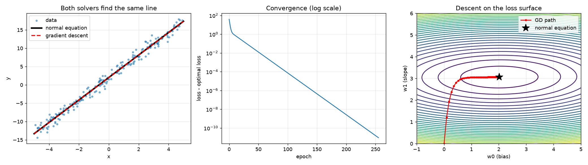
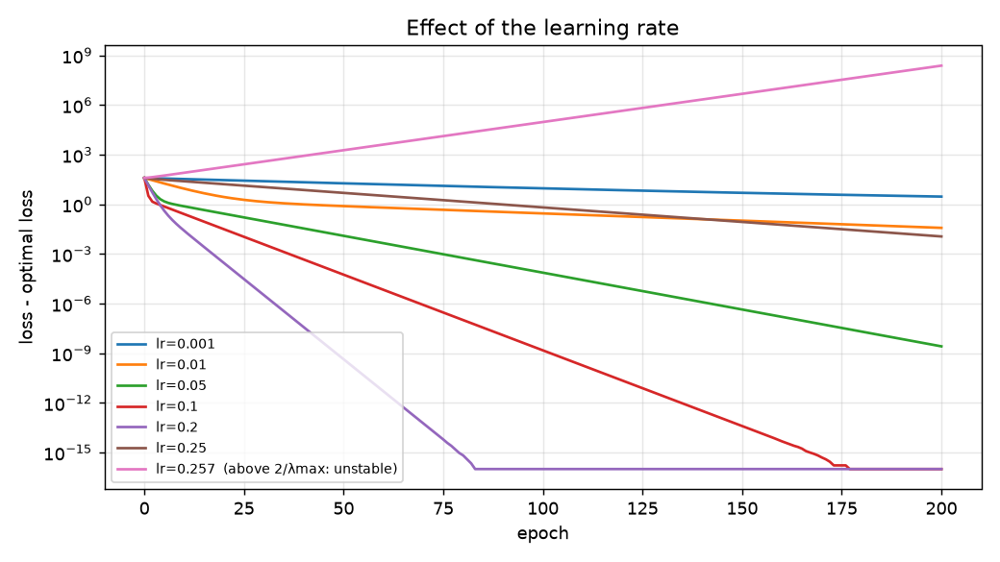
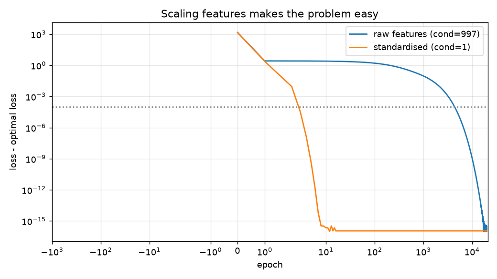
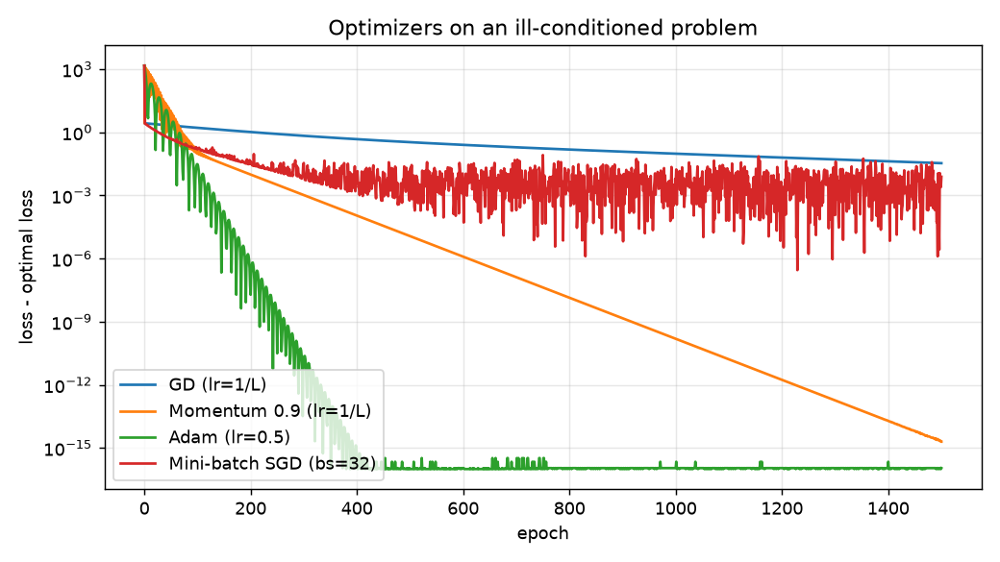
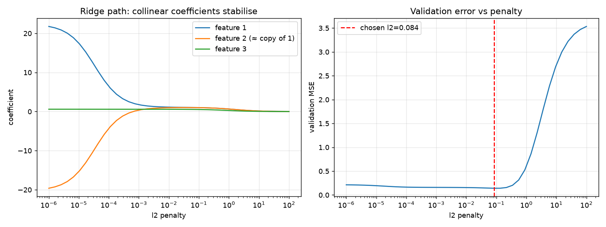
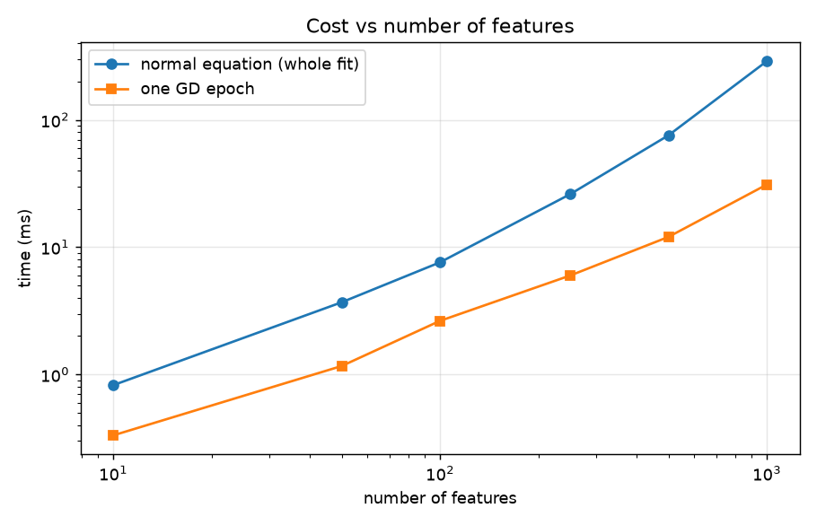

# Regression from Scratch

A small, well-tested NumPy library that fits linear (and ridge) regression two ways, with a closed-form
**normal equation** and with **gradient-based optimizers** (GD, momentum, Adam, mini-batch SGD), plus a set of
reproducible experiments that show *why* optimization behaves the way it does.

No scikit-learn, no autograd: the loss, gradient, optimizers and preprocessing are all implemented by hand and
verified against each other.

```python
from gdlab import LinearRegression, StandardScaler

Xs = StandardScaler().fit_transform(X)
exact = LinearRegression("normal", l2=0.1).fit(Xs, y)
iterative = LinearRegression("gd", optimizer="adam", lr=0.05, n_epochs=2000, l2=0.1).fit(Xs, y)
```

## Quick start

```bash
pip install -e ".[dev]"
pytest                          # 12 tests
python experiments/run_all.py   # prints results, regenerates docs/figures/*.png
```

## The math

Model `ŷ = Xw` (X has a leading column of ones for the bias), loss and gradient:

```
L(w)   = 1/(2n) ||Xw − y||²  +  (λ/2) ||w_{no bias}||²
∇L(w)  = 1/n Xᵀ(Xw − y)      +  λ w_{no bias}
```

Setting ∇L = 0 gives the normal equation `(XᵀX/n + λI′) w = Xᵀy/n`. The intercept is never regularised.
The Hessian is `XᵀX/n + λI′`; its largest eigenvalue λ_max sets the maximum stable learning rate, `2/λ_max`.

## Results

All numbers below are produced by `experiments/run_all.py` (seeded; timings vary by machine).

### 1. Correctness: three independent checks
- Analytic gradient vs. central finite differences: max difference **6.6e-9**.
- Gradient descent vs. the normal equation: weight vectors agree to **4.3e-6**.
- Ridge via GD vs. closed-form ridge: coefficients agree to **3.8e-6**.



### 2. The learning-rate stability limit, predicted and observed
Theory says GD on a quadratic diverges when `lr > 2/λ_max`. For this dataset `λ_max = 7.93`, so the limit is
**0.2521**. Measured: lr = 0.2495 converges, lr = 0.2571 blows up (loss gap ≈ 2.4e8 after 200 epochs).
Convergence speed is also *not* monotonic in lr: lr = 0.25, just under the limit, converges much more slowly
than lr = 0.2 because it oscillates around the minimum.



### 3. Feature scaling
Two features on scales 1 and 30 give a Hessian **condition number of ~997**. Using a good step size for each case
(`1/λ_max`), reaching a loss gap below 1e-4 takes **4,402 epochs on raw features vs. 3 epochs after standardising**
(condition number 1.1).



### 4. Optimizers on the ill-conditioned problem
Same raw-feature problem, 1,500 epochs:

| Optimizer | Result |
|---|---|
| Plain GD (lr = 1/L) | not converged (gap 3.4e-2) |
| Momentum 0.9 | gap < 1e-4 by epoch 405; reaches ~1e-15 |
| Adam (lr = 0.5) | gap < 1e-4 by epoch 125; reaches ~1e-16 |
| Mini-batch SGD (bs = 32) | hovers at a noise floor (~1e-2 gap) with a constant learning rate |

The mini-batch curve is noisy and only touches the 1e-4 threshold transiently; with a constant step size it never
settles. A decaying learning rate would be the standard remedy (not implemented here).



### 5. Ridge regression with collinear features
Two features are near-copies. True coefficients are `[2, 0, 0.5]`, but only the *sum* of the first two is
identifiable. Hyperparameter λ is chosen on a validation split; the numbers below are on a separate test split.

| | coefficients | test MSE |
|---|---|---|
| OLS | [21.76, −19.61, 0.60] | 0.259 |
| Ridge (λ = 0.084) | [1.02, 1.01, 0.54] | 0.233 |

OLS finds huge, cancelling coefficients; ridge splits the weight evenly, which is the sensible answer.



### 6. Cost vs. number of features (n = 5,000)
One GD epoch costs O(n·d); the normal equation costs O(n·d² + d³). On my machine, from d = 100 to d = 1000 the
normal-equation fit slowed down ~40× while one GD epoch slowed ~11×. **Caveat:** GD needs many epochs, so at these
sizes the normal equation is still the faster way to get the answer; the advantage of GD appears at much larger d,
and for models with no closed form at all.



## Project layout

```
src/gdlab/
  objective.py      loss, analytic gradient, numerical gradient
  optimizers.py     SGD (+momentum), Adam
  linear.py         LinearRegression (normal | gd; ridge; mini-batch)
  preprocessing.py  StandardScaler
  metrics.py        mse, r2_score
  data.py           synthetic data generator
tests/              12 tests: gradient check, GD≡normal eq, ridge, divergence, reproducibility, ...
experiments/        run_all.py: the six experiments above
```

## Limitations / possible extensions
- Only squared loss; logistic regression and a small neural network would be natural next steps
  (the optimizers already work on any gradient).
- No learning-rate schedules, early stopping on validation loss, or L1 regularisation.
- Experiments use synthetic data; a real dataset (e.g. California housing) would strengthen the case.

## License
MIT
